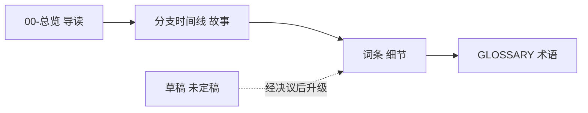

# WorldCreate

击魄／法厄同的独立设定库。本仓库只存放**设定真相**与分支叙事，不写游戏项目的玩法与程序设计文档。

## 目录

| 路径 | 用途 |
|------|------|
| [00-总览](00-总览/README.md) | 导读：世界是什么、哪些规则不能破、从哪条线读下去 |
| [词条](词条/README.md) | 细节权威源，按时间／地点／参与者／事件／概念存放 |
| [分支时间线](分支时间线/README.md) | 各区故事正文与子设定集 |
| [绘图](绘图/) | 设定向绘图说明 |
| [草稿](草稿/) | 草稿与溯源，不参与现行规则 |
| [_规范](_规范/README.md) | 仓库级约定：写作、维护、待办口径 |
| [_templates](_templates/README.md) | 文档骨架 |
| [总世界线](总世界线.md) | 分层树 + 跨区接口表 |
| [GLOSSARY.md](GLOSSARY.md) | 已决议术语；废弃说法见其中 `_Avoid_` |
| [实体与关系网](实体与关系网.md) | 已点名实体的扫描表 |

## 分工

| 库 | 回答的问题 | 典型读者 |
|----|------------|----------|
| **词条** | 这个世界的细节是什么 | 写作、美术、程序 |
| **分支时间线** | 某一段故事怎么发生的 | 写作、关卡设计 |
| **00-总览** | 从哪开始读、哪些不能破 | 新读者、协作方 |
| **草稿** | 还没定稿的想法与出处 | 作者本人 |

## 快速入口

| 我要…… | 去看 |
|--------|------|
| 先读懂这个世界 | [设定真相·总览与导读](00-总览/设定真相·总览与导读.md) |
| 查各地对同一件事的说法 | [知情对照表](00-总览/知情对照表.md) |
| 查还有哪些没敲定 | [母设定待定项汇总](00-总览/待定项汇总.md) · [云上坟场](分支时间线/法厄同/云上坟场/00-总览/待定项汇总.md) · [击魄](分支时间线/法厄同/击魄/00-总览/待定项汇总.md) |
| 查某个专名怎么用 | [GLOSSARY.md](GLOSSARY.md) |
| 查跨区因果 | [总世界线](总世界线.md) |
| 查某条规则的写法 | [_规范](_规范/README.md) |

## 维护约定

- **待定项以 issue 为记录**：条目本体在 GitHub issue，各集 `待办/*.md` 是从 issue 生成的表，不手工编辑。口径见 [_规范/待办/README.md](_规范/待办/README.md)。
- **修订历史不进正文**：结论写进提交信息，历史查 `git log`。见 [文档维护与版本策略](_规范/文档维护与版本策略.md)。
- **专名以 GLOSSARY 为准**：`_Avoid_` 里的旧说法一个字都不要用。见 [词条写作规范](_规范/词条写作规范.md)。
- **本体与游戏项目分离**：游戏项目的 `Docs/设定/` 链到本库；设定真相正文写在本库，不写进游戏项目的程序设计文档。

---

**分类：** 索引 | 仓库入口
**状态：** 2026-11-08 建立
