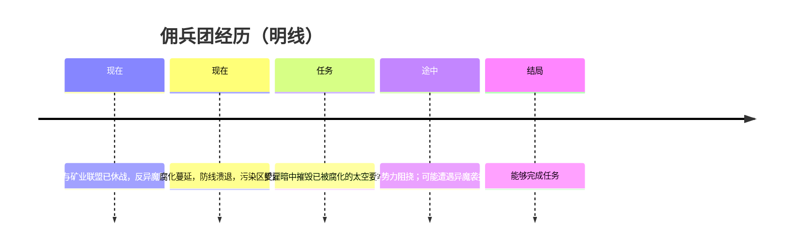

# 时间线

> 只记佣兵团所见的先后。过程见 [04-事件](../04-事件/README.md)。真相序见 [暗线 · 时间线](../../02-暗线/01-时间/时间线.md)。

| 阶段 | 状态 | 事件（只点名） |
|------|------|----------------|
| 现在 | 休战已成，阵线已组成 | [组成反异魔阵线](../04-事件/休战与阵线/组成反异魔阵线.md) |
| 现在 | 腐化蔓延；防线溃退 | [腐化蔓延](../04-事件/腐化与要塞/腐化蔓延.md) |
| 任务 | 暗中摧毁腐化要塞 | [潜入腐化要塞](../04-事件/腐化与要塞/潜入腐化要塞.md) |

---

**分类：** 明线 | 时间  
**状态：** 所见顺序已定
