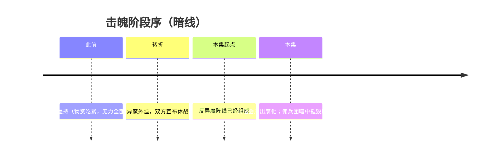

# 时间线

> 本页只记先后。过程见 [04-事件](../04-事件/README.md)。佣兵团所见见 [明线 · 时间线](../../01-明线/01-时间/时间线.md)。

击魄写抗击异魔期间。本集从真正休战之后、反异魔阵线已经组成写起。

| 阶段 | 状态 | 事件（只点名） |
|------|------|----------------|
| 此前 | 僵持：双方物资吃紧、难再全面开战，小规模冲突不断，仍未正式停战 | [僵持与休战](时期/僵持与休战.md) |
| 转折 | 异魔外溢，内战被迫结束 | [外溢迫使休战](../04-事件/休战与阵线/外溢迫使休战.md) |
| 本集起点 | 休战已成，阵线已经组成 | [组成反异魔阵线](../04-事件/休战与阵线/组成反异魔阵线.md) |
| 本集 | 共信会试验产出腐化；防线溃退 | [腐化爆发](../04-事件/腐化与要塞/腐化爆发.md) |
| 本集 | 佣兵团执行潜入任务 | [潜入腐化要塞](../04-事件/腐化与要塞/潜入腐化要塞.md) |

年份未写。
