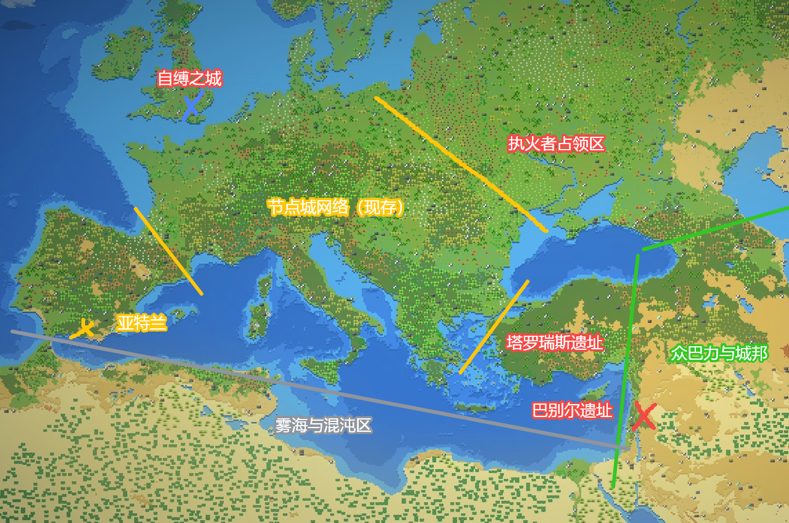
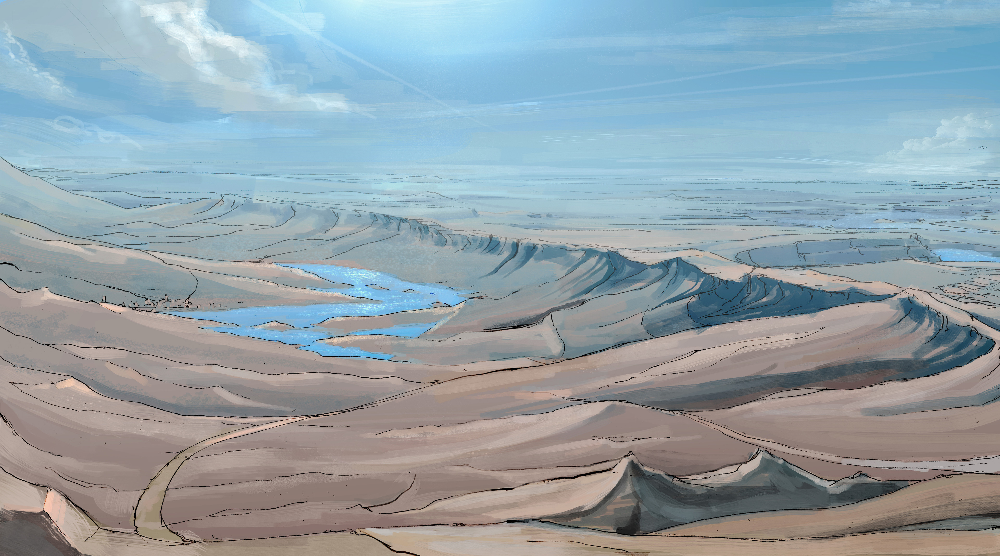
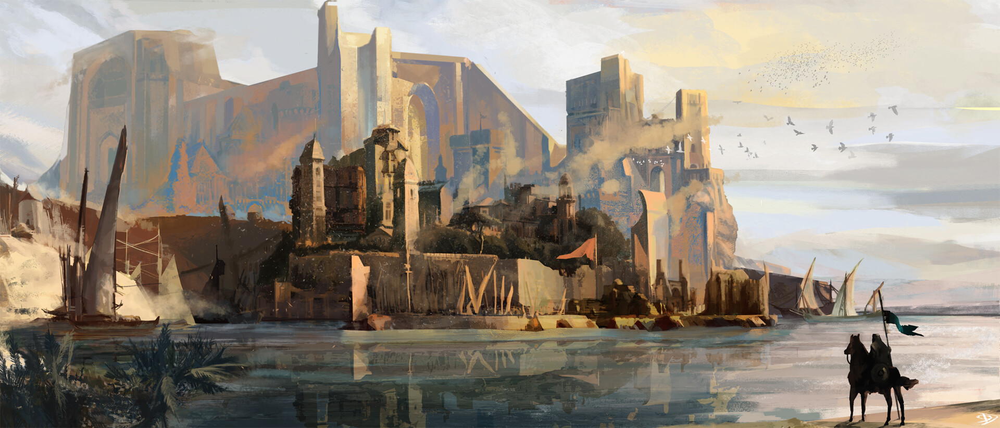

# 地面线

> 地点：[地面](../../../../词条/地点/泰拉/地面/README.md) · [众城所在地](../../../../词条/地点/泰拉/地面/众城所在地/README.md)。精灵、哈达德、渊魔只记接口，正文各归其线。

前文明贫富固化，以轨道一次交付的以太壁垒建节点城。大天灾中链接断裂、城市人隔绝以太并役使荒原；破晓时代荒原以以太技艺与自然信仰反击，执火者颠覆节点城秩序。城邦之名出现于城市人已无力清剿之时。

## 跨区接口

| 方向 | 内容 |
|------|------|
| 入（灾前） | 以太壁垒技术一次交付，见 [以太线](../../轨道/以太线.md) |
| 入（破晓） | 哈达德降临、荒野信仰变革，见以太线 |
| 入 | 精灵进入荒原、侍奉巴力，见 [精灵线](../世界树/精灵线.md) |
| 入 | 异魔结构坠落 → [深渊](../../../../词条/地点/泰拉/地面/深渊/README.md)（源不在地面） |

## 故事地图

参考图：

以陷落巨城 **塔罗瑞斯** 遗址为中心：遗址**西北**为仍运作的 [节点城网络](../../../../词条/地点/泰拉/地面/众城所在地/节点城网络/README.md)；**以东**为荒原人领土，夹着少数边境节点城或遗址（含旋塔之城 [巴别尔](../../../../词条/地点/泰拉/地面/众城所在地/巴别尔/README.md)）。

遗址**东北**曾被执火者占领。**正东至东南**为巴力·哈达德麾下众城邦（风貌近小亚细亚）。**东南外海**为 [雾海](../../../../词条/地点/泰拉/地面/众城所在地/雾海/README.md)。节点城网络向西南沿海的半岛上为海潮派所建 [亚特兰](../../../../词条/地点/泰拉/地面/众城所在地/亚特兰/README.md)；沿半岛海岸向东可抵哈达德诸城，沿途仅零星边境节点城。

### 气候与地貌（参考欧洲）

中纬西风主导：西与西南沿海湿润温和，向内陆与东部转大陆性；高纬冬季长、寒潮南下。西南海岸与半岛多低山—丘陵—潟湖；中部平原河网；东北与东部为寒冷台地、针叶林与草原；东南外海为异常以太海域。

**A. 西北—中部（节点城网络）**　海洋性向温带大陆性过渡。冬湿冷、夏温和，降水较匀。宽谷平原、低山丘陵、密河网，适于道路、运河与补给廊道。

**B. 东部荒原带**　温带大陆性至半干旱草原。冬更冷更干、夏更热；黑土草原、风蚀台地、季节性河谷与盐碱洼地，局部次生荒漠化。

**C. 东北执火者旧占领区**　寒温带／亚寒带南缘。冬严寒、积雪长；针阔混交林、冰碛丘陵、泥炭沼。多处**离散型高浓度以太区**（冷斑／亮斑），沿断裂带、古战场与旧节点残骸，单体小于雾海、扰动更随机。

**D. 西南半岛（亚特兰）**　地中海气候，北段受海洋性调节。夏干热、冬温雨。石灰岩海岸、岬角海湾；内陆丘陵梯田与低山盆地，深水港条件好。

**E. 正东至东南沿岸（哈达德众城邦）**　沿海地中海、内陆高地干冷。海岸山脉与内陆高原并置，「港城—山城—高原城」串联。

**F. 东南外海（雾海）**　冷暖气团交汇、气流与海流常不一致，低层逆温、高湿低能见。以太「连续高背景 + 深处跃迁」，越深越近不可逆阈值；规模大于东北离散高浓区。漂移雾墙、异常潮汐；岸线多盐沼、黑沙滩与断崖。

## 时间线

### 前文明末期

以太入世后贫富固化，阶层几乎分属两界。统治层制定壁垒协议，用轨道一次交付的壁垒技术建节点城。伊勒信仰沿旧脉络进入节点城秩序，政治合法性与教义互相支撑。

### 大天灾

城市群遭「大洪水」冲击，节点城断联；部分陷落（塔罗瑞斯被大地吞入）。城际本可互相锚定以稳壁垒、传资源，大部分链接失效。

链接瘫痪期间，伊勒「降临」于巴别尔，册封诸天使，塔顶建花园。天使长路西法欲与伊勒并立分权，被米迦勒击败放逐；追随者「执火派」转入地下。设定真相：路西法欲驯化伊勒为文明工具，天使阶层为既得利益将其放逐至灵界（灵界不是独立故事地区，不另开线）。

教义动员下修复链接。内城强迫外城平民在外界作业：外城平民 ≠ 荒原人；长期暴露者部分荒原化，过久者或异变为怪物，少数怪物成聚落。链接修复后资源内循环，与荒原隔绝；城市人隔绝以太，外界资源靠奴役荒原人。伊勒教将大洪水分为潮涌、洪泛、余波，作为纪年框架。

### 破晓时代

城市人封闭于内部供应链与原始能源。跨城交流催生海潮派：主张「洪水即伊勒之力」，在西南半岛建不抑制以太的亚特兰。其对滨海以太的研究引来「洋」与「殁」两类巴力存在，后被伊勒教吸纳为伊勒长子、次子。此事件在建城之后、荒原蓬勃之前。

荒原人在绝境中领悟以太技艺（生产、狩猎等，可归纳、可传承）；未继承多少旧技术，转信自然，巴力等存在响应。节点城近百年内讧中，对荒原一向隔离、驱散、奴役、清剿，并猎杀天赋者。天赋者无法颠覆所有城市，但能造成难以修复的损失。

**执火者革命**（待改：新版为执火派在荒原活动的分支；昏昼是路西法作为「晨昏星」的一个面相）：

荒原出现两名天赋者：昏昼（纳光为火，可传授）与织星者（以星空幻象传信，幻象来自以太界投射）。他们设局击溃数支联邦清剿队。昏昼自称「以昏暗挽来白昼者」；执火者夜间结成无光之火阵列，夺回荒原黑夜。残余城市组联邦议和又内耗；主张屈服者泄密，昏昼踏平各城，将屈服者驱至极北岛修 [自缚之城](../../../../词条/地点/泰拉/地面/众城所在地/自缚之城/README.md)。昏昼厌政治，执火军不地方化，而是遍布世界的军队—护民官式佣兵。他保全城市技术设备，供日后使用。

节点城被攻陷末期，**城邦**（The Enclaves）之说出现：指未被节点城保护、脱离前文明人群的荒原大型聚落——此时城市人已无力频繁打击。

伊勒信徒在节点城内定型：牧群派（受壁垒庇护，排斥以太、认为以太不可触犯）；海潮派（洪水即伊勒之力，滨海／荒原，最早系统钻研以太）；执火派不承认现世伊勒正统、追随路西法，不纳入伊勒分支。教内「执火派」≠ 昏昼的荒原执火军。

## 待改

执火者革命段落按新版（执火派荒原分支；昏昼＝晨昏星面相）重写。
