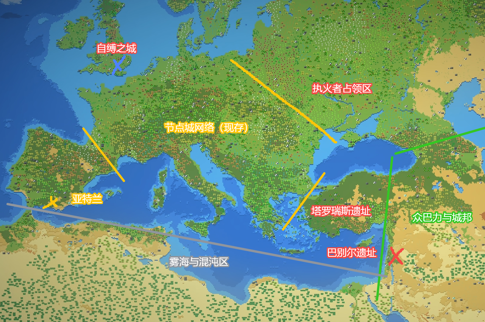
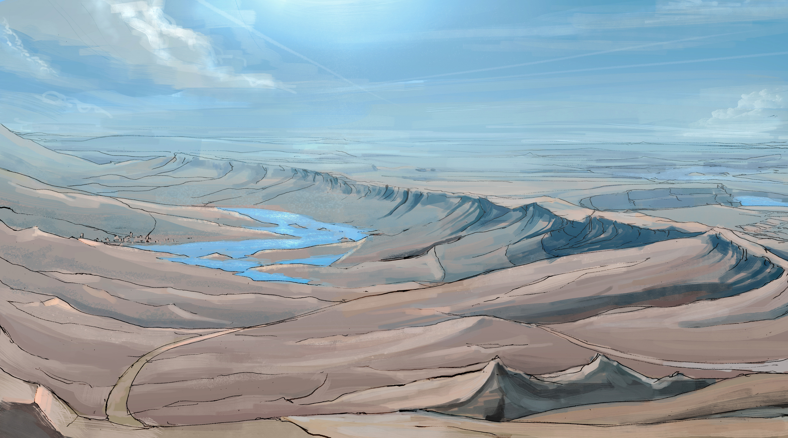
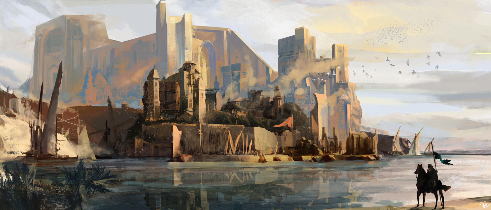

# 城市与城邦

> 地点词条见 [地面](../../../../词条/地点/泰拉/地面/README.md) 与 [诸城所在之地](../../../../词条/地点/泰拉/地面/诸城所在之地/README.md)。

前文明贫富固化。统治层用轨道研究站一次交付的以太壁垒技术建成节点城。大天灾中，城与城之间的链接断裂。城市人隔绝以太，并役使荒原人。大天灾之后，荒原人的以太技艺与自然信仰逐渐兴起。执火者掀起革命，颠覆节点城秩序，并把城市人放逐到极北。城邦这个名称，出现在城市人已经无力清剿荒原聚落的时候。

## 跨区接口

| 方向 | 内容 |
|------|------|
| 入（灾前） | 以太壁垒技术一次交付，见 [源质实体的起源](../../轨道/源质实体的起源.md) |
| 入（哈达德降临） | 哈达德降临、荒野信仰变革，见 [源质实体的起源](../../轨道/源质实体的起源.md) |
| 入 | 精灵进入荒原、侍奉巴力，见 [自远方祖树而来的精灵们](../世界树/自远方祖树而来的精灵们.md) |
| 入 | 异魔结构坠落 → [深渊](../../../../词条/地点/泰拉/地面/深渊/README.md)，源不在地面 |

## 故事地图

参考图：

故事地图以陷落的巨城 **塔罗瑞斯** 遗址为中心。遗址**西北**仍是运作中的 [节点城网络](../../../../词条/地点/泰拉/地面/诸城所在之地/节点城网络/README.md)。遗址**以东**是荒原人的领土，领土里夹着少数边境节点城或遗址，其中有旋塔之城 [巴别尔](../../../../词条/地点/泰拉/地面/诸城所在之地/巴别尔/README.md)。

遗址**东北**曾被执火者占领。**正东至东南**是巴力·哈达德麾下的众城邦，风貌接近小亚细亚。**东南外海**是 [雾海](../../../../词条/地点/泰拉/地面/诸城所在之地/雾海/README.md)。从节点城网络向西南，沿海半岛上是海潮派所建的 [亚特兰](../../../../词条/地点/泰拉/地面/诸城所在之地/亚特兰/README.md)。沿半岛海岸向东可以抵达哈达德诸城，沿途只有零星的边境节点城。

### 气候与地貌（参考欧洲）

中纬西风主导：西与西南沿海湿润温和，向内陆与东部转大陆性；高纬冬季长、寒潮南下。西南海岸与半岛多低山—丘陵—潟湖；中部平原河网；东北与东部为寒冷台地、针叶林与草原；东南外海为异常以太海域。

**A. 西北—中部（节点城网络）**　海洋性向温带大陆性过渡。冬湿冷、夏温和，降水较匀。宽谷平原、低山丘陵、密河网，适于道路、运河与补给廊道。

**B. 东部荒原带**　温带大陆性至半干旱草原。冬更冷更干、夏更热；黑土草原、风蚀台地、季节性河谷与盐碱洼地，局部次生荒漠化。

**C. 东北执火者旧占领区**　寒温带／亚寒带南缘。冬严寒、积雪长；针阔混交林、冰碛丘陵、泥炭沼。多处**离散型高浓度以太区**（冷斑／亮斑），沿断裂带、古战场与旧节点残骸，单体小于雾海、扰动更随机。

**D. 西南半岛（亚特兰）**　地中海气候，北段受海洋性调节。夏干热、冬温雨。石灰岩海岸、岬角海湾；内陆丘陵梯田与低山盆地，深水港条件好。

**E. 正东至东南沿岸（哈达德众城邦）**　沿海地中海、内陆高地干冷。海岸山脉与内陆高原并置，「港城—山城—高原城」串联。

**F. 东南外海（雾海）**　冷暖气团交汇、气流与海流常不一致，低层逆温、高湿低能见。以太「连续高背景 + 深处跃迁」，越深越近不可逆阈值；规模大于东北离散高浓区。漂移雾墙、异常潮汐；岸线多盐沼、黑沙滩与断崖。

## 壁垒与节点城

以太进入现世之后，贫富固化，阶层几乎分属两界。统治层制定壁垒协议，用轨道研究站一次交付的以太壁垒技术建成节点城。伊勒信仰沿着旧有脉络进入节点城的秩序。政治上的合法性与教义互相支撑。

## 大天灾

### 断联与陷落

城市群遭到「大洪水」冲击。节点城之间的链接断开，一部分城市陷落。大地把塔罗瑞斯吞入腹中，地表留下遗址。城与城本来可以互相锚定，用来稳住壁垒、传递资源；大部分链接失效。

### 伊勒降临与路西法陨落

链接瘫痪期间，伊勒「降临」于巴别尔，在旋塔之顶册封诸天使。塔顶建起花园。天使长路西法想与伊勒并列分掌权力。米迦勒击败路西法，并把路西法放逐。路西法的追随者「执火派」转入地下活动。设定真相：路西法想把伊勒驯化成文明所用的工具。天使阶层出于既得利益，把路西法放逐到灵界。灵界不是独立的故事地区，不另开故事线。

### 修复与隔绝

城市人在教义动员下，修复城与城之间的链接。内城强迫外城平民到外界作业。这些外城平民与荒原人不同。长期暴露在外界的人，有一部分荒原化；暴露过久的人，有的异变为怪物，少数怪物形成聚落。链接修复之后，城市人让资源在城内循环，并与荒原隔绝。城市人隔绝以太，靠奴役荒原人取得外界资源。伊勒教把大洪水分成潮涌、洪泛、余波，用来纪年。

## 执火者革命

### 节点城内的派系

城市人封闭在内部供应链与原始能源里。跨城交流催生出[海潮派](../../../../词条/参与者/势力/海潮派.md)。海潮派主张「洪水乃伊勒之力」，在西南半岛建起不抑制以太的亚特兰。海潮派研究滨海的以太，引来「洋」与「殁」这两类巴力存在。伊勒教后来把二者吸纳为伊勒的长子与次子。这件事发生在亚特兰建成之后、荒原兴盛之前。

### 荒原的技艺与信仰

荒原人在绝境中领悟以太技艺，用于生产、狩猎等事务。这些技艺可以归纳，也可以传承。荒原人没有继承多少旧技术，转而信奉自然，巴力等存在响应这种信仰。节点城近百年内讧期间，城市人对荒原人一向隔离、驱散、奴役、清剿，并猎杀天赋者。天赋者无法颠覆所有城市，但能对城市造成难以修复的损失。

### 执火者革命

执火派转入地下之后并没有停止活动。他们不承认现世伊勒的正统，把现世伊勒视为「伪作者」，把教会所述的洪水史与职阶神学当作掌权者改写的产物，在节点城内秘密保存被删改的历史，并织成反抗网络。网络成员多来自受压制的外城神职、低职阶工匠、抄录者与以太技艺者。

大天灾之后，节点城内外出现两名强大的天赋者：昏昼与织星者。昏昼自称「以昏暗挽来白昼者」，是执火军的领导者，也是大执火者。他掌握「纳光为火」。这是一项可以传授、可以复现的以太技艺。织星者能用星空幻象传递消息。这些幻象来自以太界的投射。在宗教叙事中，人们把昏昼视为路西法反抗伊勒秩序的代理人，也视为路西法以「晨昏星」这个身份在现世显现的一个面相。城市人称投奔路西法一方的以太技艺者为「投奔魔鬼者」。昏昼是这群人的救星与旗帜。详参 [晨昏星](../../../../词条/参与者/人物/晨昏星.md)、[昏昼](../../../../词条/参与者/人物/昏昼.md)。

执火者与其他荒原人一起设局，击溃数支联邦联合起来的清剿队。夜间，执火者结成无光之火的长蛇，从城市人手中夺回荒原上的黑夜。城市人从此不敢走夜路，也几乎不敢在荒原过夜。最后剩下的众城被迫组成最后的联邦，与昏昼议和。议和期间，联邦内耗不止。主张屈服的人，其密谋泄露出来。昏昼踏平联邦的每一座城市，把屈服者赶到极北的岛上，令他们修建 [自缚之城](../../../../词条/地点/泰拉/地面/诸城所在之地/自缚之城/README.md)。

昏昼厌恶政治，不让执火军成为地方政权。执火军转变为遍布世界的佣兵组织，取军队与护民官的形态，为有需要的人提供有保障、有信用的安保服务。昏昼保全城市的技术设备，供日后使用。节点城被攻陷的末期，出现了 **城邦**（The Enclaves）这个说法。它指没有受到节点城保护、已经脱离前文明人群的荒原大型聚落。此时城市人已经无力频繁打击这些聚落。

### 城内教派定型

伊勒的信徒在节点城内定型为两支。[牧群派](../../../../词条/参与者/势力/牧群派.md)受壁垒庇护，排斥以太，认为以太不可触犯。[海潮派](../../../../词条/参与者/势力/海潮派.md)认为洪水是伊勒之力，行于滨海与荒原，是最早系统钻研以太的一支。执火派不承认现世伊勒的正统，追随路西法，因而不属于伊勒信仰的分支。教内的「执火派」与昏昼领导下的荒原执火军不是同一支编制。
