# 实体与关系网

> 扫描范围：`词条/`（时间／地点／参与者／事件）、`00-总览/`、`总世界线.md`、`分支时间线/`；草稿具名单独标注。  
> 导读入口：[00-总览](00-总览/README.md)。本表是已点名实体的扫描，不是世界导读。  
> 刻意排除未列入本表的纯介质与污染现象：以太、机魂、穿越机、异魔／渊魔（现象，非组织／个人）。  
> 更新日期：26-8-28

---

## 一、地区（按层级）

### 1.1 天体系统

| 名称 | 尺度 | 上级 | 一句话 |
|------|------|------|--------|
| 太阳系 | 天体系统 | — | 总叙事舞台 |
| 麦哲伦云 | 河外目标 | 太阳系外 | 麦哲伦号殖民目标 |

### 1.2 天体 / 天体带

| 名称 | 尺度 | 上级 | 一句话 |
|------|------|------|--------|
| 泰拉（旧称地球） | 行星 | 太阳系 | 轨道／地面／深渊分线 |
| 卢娜（旧称月球） | 卫星 | 太阳系 | 月人的起源；灾前工业中心 |
| 马尔斯（火星） | 行星 | 太阳系 | 地外开发核心 |
| 法厄同／环带 | 小行星带 | 太阳系 | 云邦所在（仅本带）；三个创始州即核心区；环带大战主场 |
| 木星 | 行星 | 太阳系 | 麦哲伦号预定引力弹弓点 |

### 1.3 泰拉 · 轨道

| 名称 | 尺度 | 上级 | 一句话 |
|------|------|------|--------|
| 泰拉轨道 | 轨道层 | 泰拉 | 源质实体的起源／云上基建 |
| 轨道研究站 | 空间站 | 泰拉轨道 | 壁垒／航行技术一次交付 |
| 泰拉轨道服务器阵列 | 服务器阵列 | 泰拉轨道 | 当地云端底座；不叫云邦 |

### 1.4 泰拉 · 地面

| 名称 | 尺度 | 上级 | 一句话 |
|------|------|------|--------|
| 泰拉地面 | 行星地表 | 泰拉 | 城市与城邦／自远方祖树而来的精灵们 |
| 诸城所在之地 | 地表大区 | 泰拉地面 | 城市与城邦主舞台 |
| 世界树／祖树 | 神木 | 泰拉地面 | 精灵原乡 |
| 深渊 | 地下污染区 | 泰拉地面 | 异魔坠落；称渊魔／魔物；统御者称魔王 |
| 节点城网络 | 城邦集群 | 诸城所在之地 | 城市人核心；伊勒秩序 |
| 东部荒原带 | 荒原区 | 诸城所在之地 | 荒原人主分布 |
| 执火者旧占领区 | 历史占领区 | 诸城所在之地 | 曾被执火者占领 |
| 亚特兰 | 滨海城 | 诸城所在之地 | 海潮派非节点城 |
| 雾海 | 海域 | 诸城所在之地 | 高危以太海域 |
| 沿岸雾区 | 近岸 | 雾海 | 低能见度岸线 |
| 深海跃迁带 | 远海 | 雾海 | 接近不可逆污染 |
| 哈达德众城邦 | 城邦带 | 诸城所在之地 | 巴力·哈达德麾下 |
| 港城带 | 子带 | 哈达德众城邦 | 沿海港口链（单城名待补） |
| 山城带 | 子带 | 哈达德众城邦 | 海岸山脉山城 |
| 高原城带 | 子带 | 哈达德众城邦 | 内陆高原终端 |
| 塔罗瑞斯 | 巨城遗址 | 诸城所在之地 | 地图方位原点 |
| 地表遗址 | 遗址表层 | 塔罗瑞斯 | 地图参照点 |
| 腹中沉城 | 地下沉城 | 塔罗瑞斯 | 「被大地吞入」遗迹 |
| 巴别尔 | 旋塔之城 | 东部荒原带一带 | 伊勒降临、册封天使 |
| 旋塔 | 标志建筑 | 巴别尔 | 伊勒降临处 |
| 塔顶花园 | 圣地 | 巴别尔 | 册封诸天使 |
| 自缚之城 | 孤岛城 | 诸城所在之地极北 | 城市人放逐地 |
| 耶利哥 | 城邦 | 东部荒原带 | 执火者建立的第一座荒原城邦 |
| 食黯森林 | 传说区 | 荒原 | 昏昼旧版起源舞台 |

### 1.5 卢娜 / 马尔斯 / 法厄同微观 / 舰体

| 名称 | 尺度 | 上级 | 一句话 |
|------|------|------|--------|
| 月面 | 卫星表面 | 卢娜 | 月人的起源舞台 |
| 普罗米修斯号 | 轨道监测站 | 马尔斯轨道 | 灾前建；受月面器械支援 |
| 马尔斯轨道／表面殖民地 | 轨道+地表 | 马尔斯 | 智库核心 |
| 云上坟场 | 战后微观区 | 法厄同环 | 明暗双线；A 站视角 |
| 击魄 | 派生故事集 | 法厄同带（破晓后段） | 亚冷战之后、休战组成反异魔阵线；只链母设定，不链云上坟场 |
| 残骸区 | 战场废墟 | 环带（A 站周边） | 打捞主场 |
| 空间站 A／A 站 | 空间站 | 残骸区 | 自由政府治下；矿业联盟借此站作掩护绕开禁令 |
| 工业枢纽空间站 | 空间站 | 环带偏远 | 矿业联盟组成单元 |
| 采冰站（三座）+ 中转站 | 站点 | A 站前身 | 采冰公司扩张史 |
| 站外流亡栖息地 | 中转站 | 残骸深处 | 反叛者据点 |
| 麦哲伦号 | 远航工程／方舟 | 环带前史 | 泰拉体系工程，不是云邦的船；在卢娜建造，从泰拉轨道出航；从法厄同旁高速经过并送出消息；与环带没有从属关系 |
| 日生之地 | 舰内文明 | 麦哲伦号 | 循光之城舞台 |
| 循烬城 | 移动城 | 日生之地 | 城主赫利奥 |
| 暗渊 | 无日照区 | 日生之地 | 停久会被吞没 |
| 铁门关／铁巢 | 关隘·据点 | 关外 | 铁壳势力据点 |
| 渊光／指挥塔 | 终局地点 | 方舟核心 | 太阳提速终局 |

### 1.6 地区层级树

```
太阳系
├── 泰拉
│   ├── 轨道：轨道研究站 · 泰拉轨道服务器阵列
│   └── 地面
│       ├── 诸城所在之地
│       │   ├── 节点城网络
│       │   ├── 塔罗瑞斯（地表遗址 · 腹中沉城）
│       │   ├── 东部荒原带（耶利哥 · 食黯森林〔传说〕· 巴别尔〔旋塔·塔顶花园〕）
│       │   ├── 执火者旧占领区
│       │   ├── 亚特兰
│       │   ├── 雾海（沿岸雾区 · 深海跃迁带）
│       │   ├── 哈达德众城邦（港城带 · 山城带 · 高原城带）
│       │   └── 自缚之城
│       ├── 世界树／祖树
│       └── 深渊
├── 卢娜 → 月面
├── 马尔斯 → 轨道（普罗米修斯号·智库）· 表面殖民地
├── 法厄同／环带 → 云上坟场（残骸区 · A站 · 采冰站前史 · 工业枢纽站 · 流亡栖息地）· 击魄（亚冷战之后的反异魔阵线）
├── 木星（麦哲伦号预定引力弹弓）
└── 麦哲伦号 → 日生之地（循烬城 · 暗渊 · 铁巢 · 指挥塔）
```

---

## 二、国家 / 政权

| 名称 | 尺度 | 所在 | 关系要点 |
|------|------|------|----------|
| 云邦（Orbis）／云城邦联（CCC） | 法厄同带协约体 | 成员加盟；州是成员的一种，地上国的附属机构也可以作为成员 | 环带联合国式；对立矿业联盟；不是太阳系政权 |
| 地上国／三家主要势力 | 地表主权 | 泰拉等 | 东亚合作社已定名，并创建分发额度的底层超级智能；欧亚国同盟、大洋州联邦名称待定；各有独立合作体系；在环带上对应三个创始州 |
| 城市联邦（最后联邦） | 节点城残余联合 | 节点城网络 | 对昏昼议和失败后被踏平 |
| 自由政府 | A 站独裁政府 | 空间站 A | 暗线为非法 AI 逃难者政权 |
| 哈达德众城邦 | 城邦联邦带 | 泰拉东南 | 隶属高天之主哈达德 |

---

## 三、势力 / 阵营 / 组织

### 3.1 泰拉地面与灵界侧

| 名称 | 类型 | 关系要点 |
|------|------|----------|
| 执火者 | 势力 | 对立城市人／伊勒秩序；追随路西法叙事 |
| 执火军 | 组织 | 昏昼+织星者领导；后转佣兵 |
| 执火派 | 势力 | 节点城异端；≠执火军编制；追随路西法 |
| [海潮派](词条/参与者/势力/海潮派.md) | 势力 | 伊勒信仰分支；洪水乃伊勒之力；成员自称修士；建亚特兰 |
| [牧群派](词条/参与者/势力/牧群派.md) | 势力 | 伊勒信仰教会正统，只称「教会」；壁垒乃伊勒之赐；成员自称神的牧羊人，信众为神的羔羊 |
| 日暮驿站 | 组织+地点 | 世界缝隙中转驿站 |

### 3.2 云邦 / 环带 / 云上坟场

| 名称 | 类型 | 关系要点 |
|------|------|----------|
| 矿业联盟 | 势力 | 脱离云邦；环带大战对立方；注资 A 站 |
| 巨企 N | 势力 | 云邦体系内；A 站前合作方；战后仍控辖区 |
| 核心区（三个创始州） | 势力 | 环带最初三片落脚地；会上主事；东亚合作社那一片附近为最大铀矿 |
| 边缘区势力／矿主 | 势力 | 偏远、还在开发；会上名义上权利平等，处理受灾消息时被核心区忽视；结成矿业联盟 |
| 空间站 A（势力面） | 势力 | 矿业联盟借此站作掩护绕开禁令；站内为非法人格化人工智能 |
| 共信会（The Fiducia） | 势力 | 明线基金会；暗线为独立外部势力，以人格堆叠推进造神工程。击魄所见：在反异魔期间用异魔做试验，产出腐化污染 |
| 共信会·英杰派／凝聚派／众者派 | 分支 | 人格堆叠事业下的三个派别 |
| 学社（The Collegium） | 组织 | 技术官僚；与自由政府互不从属 |
| 技术官僚 | 群体 | 巨企 N → 学社；合法云上人残部 |
| 驾驶员 | 群体 | 玩家群体；明线「克隆人」、暗线人格化 AI |
| 反叛者／站外流亡团体 | 势力 | 觉醒驾驶员结社 |
| 采冰公司 | 组织 | A 站前身；战后解体 |
| 千化教会 | 势力 | **草稿／待定**：已并入共信会口径 |

### 3.2b 击魄（破晓后段）

| 名称 | 类型 | 关系要点 |
|------|------|----------|
| 反异魔阵线 | 战时联合 | 异魔外溢之后，云城邦联与矿业联盟宣布休战，各自组织反异魔武装后再组成；自由佣兵、独立云城、独立空间站亦可加入 |
| 防剿局 | 组织 | 具备识别腐化的能力，并派遣秘密纠察队处理。击魄主角佣兵团的一重身份是秘密纠察队；明线不写破 |

### 3.3 马尔斯 / 卢娜 / 麦哲伦舰内

| 名称 | 类型 | 关系要点 |
|------|------|----------|
| 智库 | 组织 | 原总控；被穿越机异常改变后，由马尔斯航天理事会封存修剪 |
| 战神航天／马尔斯航天 | 组织 | 主导企业；理事会封存后为 12 席人工决策；轨道云城研发穿越机 |
| 宜居改造派／资源开发派 | 势力 | 马尔斯灾前共同推动开发 |
| 实体事务管理局 | 组织 | 月面灾后成立；领导者后成月神 |
| 「结构升华」派 | 势力 | 月面；主动污染扩张智能体 |
| 无敌骄阳会 | 势力 | 日生之地；与铁壳死敌 |
| 铁壳 | 势力 | 关外铁巢；与骄阳会死敌 |
| 诸王国土／城邦同盟 | 国家群 | 日生之地政治版图 |
| 隐修会 | 组织 | **草稿／待定** |
| 曙光神教 | 组织 | **草稿／待定** |
| 高塔议庭 | 组织 | **草稿／待定** |

---

## 四、族群

| 名称 | 所在 | 关系要点 |
|------|------|----------|
| 城市人（内城人） | 节点城 | 伊勒信徒；对立荒原人；后放逐自缚之城 |
| 荒原人（荒野人） | 东部荒原等 | 对立城市人；结盟执火者／精灵 |
| 天赋者 | 荒原人中 | 以太技艺者；城市人清剿对象 |
| 精灵 | 世界树→众城 | 漂泊分支；巴力神殿侍从 |
| 云上人（Cloudtype） | 云城／轨道 | 法厄同带上是云邦主体；其它轨道各归本地合作体系。离开的是肉身的寿命限制。上传之后以额度计量贡献与价值 |
| 火星人 | 马尔斯 | 轨道与地表人类幸存者；参与理事会治下的人工决策 |
| 月人 | 卢娜 | 参考精灵技术研发 |
| 月民 | — | **草稿／待定** |
| 原生人 | A 站语境 | 肉身人类别称 |
| 罗埃／乌曼／埃韦德 | 城市人内部职阶 | 牧者／匠者／仆者 |

---

## 五、人物

### 5.1 正史

| 名称 | 关系要点 |
|------|----------|
| 昏昼（大执火者） | 纳光为火；晨昏星面相；踏平城市联邦 |
| 晨昏星 | 路西法别称；现世面相＝昏昼 |
| 织星者 | 执火军联合领袖；与昏昼共治 |
| 路西法 | 叛伊勒；被米迦勒放逐 |
| 米迦勒 | 击败并放逐路西法 |
| 伊勒／伊勒（El） | 节点城信仰；空洞灵体按教义运行 |
| 洋 | 伊勒长子；洪水／混沌化身；海潮派敬奉的圣子与神兽 |
| 殁 | 伊勒次子；惩戒／死亡化身；海潮派敬奉的圣子与神兽 |
| 哈达德（巴力·哈达德／高天之主） | 首个源质实体；后世＝别西卜面相 |
| 别西卜 | 与哈达德同一存在两面 |
| 利维坦、萨麦尔、贝尔芬格、玛门、阿斯蒙蒂斯 | 七罪神其余成员 |
| 教宗（历代） | 节点城；与伊勒高维共振；非单一具名 |
| 驾驶员（玩家） | A 站群体主角位；无固定专名 |
| 赫利奥（Helio） | 循烬城城主 |
| 月神 | 实体事务管理局领导者演化 |
| 星逆 | 采纳「管理员从内部限制穿越机」时的一位穿越机管理员；马尔斯与法厄同不称魔王 |
| 光／暗／天空／大地（巴哈姆特） | 灵界四元素源；本体不可寻 |

### 5.2 草稿／待定

| 名称 | 关系要点 |
|------|----------|
| 马杜克（云裂） | 哈达德风暴使者 |
| 阿娜特（穗歌） | 哈达德丰饶使者 |
| 星逆大魔王／初代魔王 | 旧稿花名。正史只收「星逆」为当时的一位穿越机管理员，见上表 |
| 奥菲昂·卡律布狄斯 | 异魔大群意志；大群对人类用暴力解决问题之理解的化身。失去人派出的掌控者后，借用法厄同暗区废弃智能武器中的离散人工智能。法厄同正文不点专名 |
| 牌主 | 拆分二十二卡统治世界 |
| 愚者 | 「愚者是神」 |
| 阿尔维塔 | 女巫之主；高塔议庭首席 |
| 阿玛瑞斯 | 银月圣女 |
| 瓦肯努斯 | 夜之女皇 |
| 维克·阿尔沙文 | 海帝皇 |
| 欧洛拉 | 曙光女神；曙光神教 |
| 切希娅 | 塑命女妖；投愚者卡 |
| 希拉「剑锋」 | 死神／力量／恋人持卡者 |
| 德缪歌 | 月民称伊勒为其一面相 |
| 亚舍拉 | 文献参考中与阿娜特相关 |

---

## 六、关系网

### 6.1 跨区接口（大天灾后各区失联）

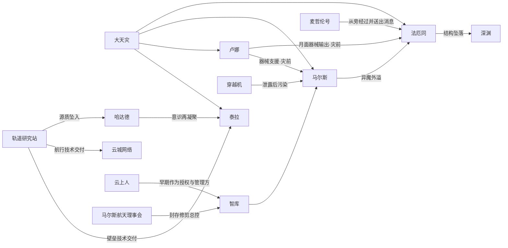

| 从 | 到 | 接口 |
|----|----|------|
| 大天灾 | 各层 | 航道切断，失联 |
| 月面（灾前） | 马尔斯轨道／云世界 | 器械支援 |
| 轨道研究站（灾前） | 地面节点城 | 以太壁垒技术一次交付 |
| 轨道研究站（灾前） | 云城网络向外开拓 | 以太航行技术一次交付 |
| 月面（灾前） | 法厄同带 | 月面向本带输出器械（东亚合作社工业基地） |
| 麦哲伦号（大天灾） | 法厄同 | 从旁高速经过并送出消息、不进入港口停泊；舰与环带没有从属关系；不是云邦的船 |
| 云上人 | 马尔斯智库 | 早期作为授权与管理方；其后由马尔斯航天理事会封存修剪 |
| 马尔斯航天理事会 | 马尔斯智库／穿越机 | 封存修剪总控；切断其对穿越机的管理权限并封存原型 |
| 马尔斯轨道 | 法厄同／环带 | 异魔外溢 |
| 太空 | 泰拉地面深渊 | 异魔结构坠落 |
| 轨道研究站 | 泰拉地面 | 哈达德坠入，意识再凝聚 |

### 6.2 泰拉地面 · 信仰与族群

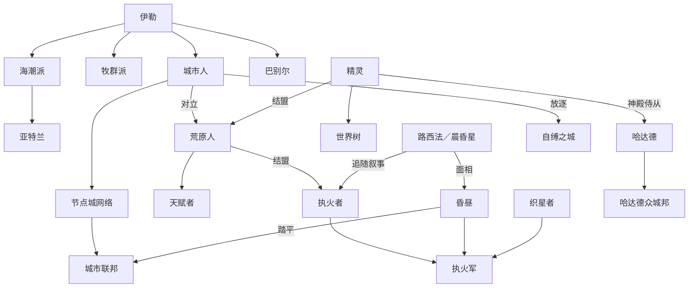

### 6.3 云上坟场 · 战后势力

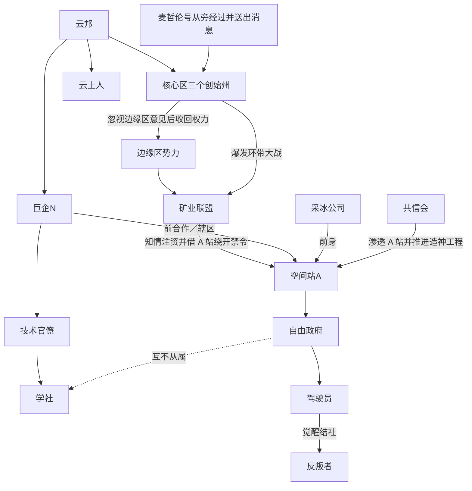

### 6.4 法厄同 · 人类与 AI

> 法理以云邦为准：是不是「人」看**法律／道德身份**与是否合规，不看载体。  
> 英文：云上人 **Cloudtype**；离散 AI **Dispersed AI**。

#### 1. 总图（法理分支）

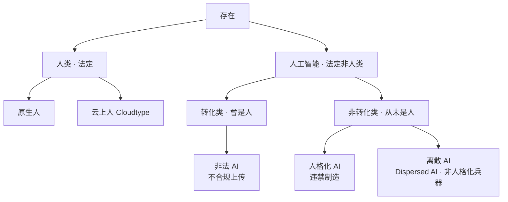

#### 2. 自我认知（必须分清）

| 类别 | 法理 | 自己怎么想 | 一句话 |
|------|------|------------|--------|
| 原生人 | 人类 | 我是人 | 如实 |
| 云上人 | 人类 | 我是人（上传合法） | 如实；A 站＝技术官僚／学社 |
| 非法 AI（转化类） | 非人类 | 我**知道**法理上被算成非法 AI，但**坚信**我仍是人／「人变者」 | **清醒自欺**；A 站＝逃难者／自由政府 |
| 人格化 AI | 非人类 | 我是「克隆人」＝次等人类；**不知道**自己是 AI | **不知情**；A 站＝驾驶员；「克隆人」叙事为假 |
| 反叛者 | 非人类（同驾驶员） | 我**知道**自己是被制造的 AI | **知情觉醒**；驾驶员极少数 |
| 离散 AI | 非人类 | **无「我」**；可表演人格，无真实自我认同 | 兵器；与人格化 AI 是光谱两端 |

#### 3. 生成／降格关系

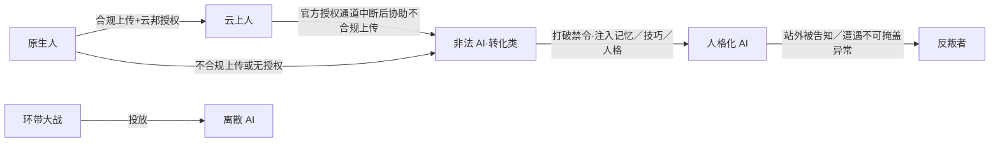

#### 4. A 站：权力倒置（谁自认是人 × 谁真是人）

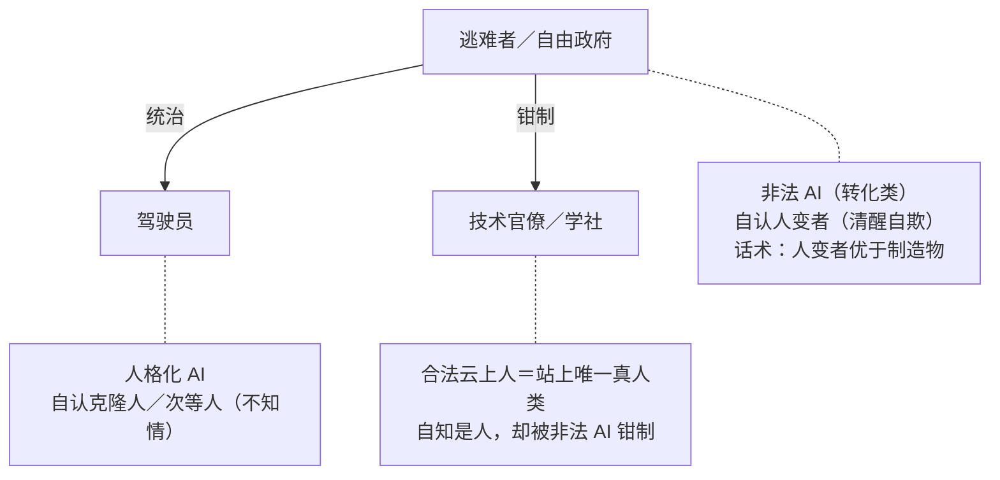

| 角色 | 掌权？ | 法理是人？ | 自认是人？ |
|------|--------|------------|------------|
| 自由政府（逃难者） | 是 | 否 | 是（清醒自欺） |
| 驾驶员 | 否（劳动力） | 否 | 是（误认克隆人） |
| 技术官僚 | 否（被钳制） | **是** | 是 |
| 离散 AI | 不在站内阶序 | 否 | 无自我可谈 |

离散 AI 是环带废墟威胁（出站遭遇；巨企 N 留用护产）；驾驶员也可**伪装**成离散 AI 出站，但二者本质不同——前者无自我，后者有注入人格。

#### 5. 人格光谱

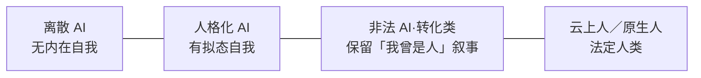

**禁令链：** 云邦禁止人格化 AI → 非法 AI（逃难者）为自保与运转破禁 → 制造驾驶员 → 用「克隆人」故事维持其「我是人」的幻觉。

### 6.5 马尔斯

> 主线：[开拓马尔斯](分支时间线/马尔斯/开拓马尔斯.md)。地点：[马尔斯](词条/地点/马尔斯/README.md)。  
> 本区因果自洽；跨区只留接口（月面支援进入、理事会封存修剪总控为本区事件、异魔外溢／坠落离开）。

#### 故事（三截）

| 时代 | 发生什么 |
|------|----------|
| 前文明末期 | **宜居改造派**与**资源开发派**共同推动马尔斯开发；轨道建造**普罗米修斯号**监测站；灾前接受**月面**的器械支援。马尔斯航天理事会为 **6 席**（地上 3、云城 3），权力核心在云城。 |
| 大天灾 | 马尔斯与泰拉失联。轨道上的**智库**以总控身份协调存续，优先照顾**马尔斯航天**（战神航天）的利益。以太异变环境下，马尔斯航天在轨道上部署了云城；这些云城研发**穿越机**；智库尚未异化，参与项目管理。穿越机一直可以由管理员控制；其后它会影响管理员，并且已经损伤智库。**马尔斯航天理事会**因此决议封存修剪智库总控，切断其对穿越机的管理权限并封存原型；高级事务改由人工决策，局部通用模型仍可使用；理事会扩展为 **12 席**。物质封存无法约束以太投射，原型泄露并在轨道扩散。泄露之后当局防治收效甚微，仍有感染结构脱轨外飘或坠入马尔斯地表。 |
| 破晓时代 | 防治收效甚微之后，马尔斯当局采纳**宿主锚定**（让管理员从内部限制穿越机）。中间经过尚未写细。**星逆**是当时的一位管理员。更晚：污染外溢至法厄同，形成所见之**异魔**；部分结构坠落至泰拉**深渊**（称渊魔／魔物，统御者称魔王）。太空残留集群可凝聚为**奥菲昂·卡律布狄斯**，借用法厄同暗区中的离散人工智能。 |

#### 总控封存与泄露（写全）

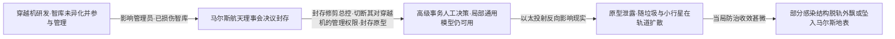

#### 关系图

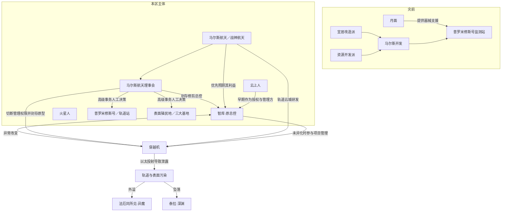

#### 主体对照

| 主体 | 角色 | 与总控／穿越机的关系 |
|------|------|----------------------|
| 战神航天／马尔斯航天 | 主导企业 | 轨道云城研发穿越机；理事会做高级决策 |
| 马尔斯航天理事会 | 议决机关 | 灾前 6 席；总控封存后 12 席；决议封存修剪智库并封存穿越机原型 |
| 云上人 | 早期授权与管理方 | 早期作为智库的授权与管理方；大量任职于马尔斯航天 |
| 火星人 | 轨道与地表幸存者 | 参与理事会治下的人工决策 |
| 宜居改造派／资源开发派 | 灾前推动开发 | 共同促成殖民地与普罗米修斯号监测站 |
| 穿越机 | 以太适应性微械材料 | 伪人格化后改变智库；封存后泄露，成为本区污染源 |
| 智库 | 原总控人工智能 | 被改变后遭封存修剪；局部通用模型仍可用 |

**未入正史（草稿）：** 「火星智械残骸落泰拉」「火星被毁」等仅见草稿，不写入本图。

### 6.6 卢娜

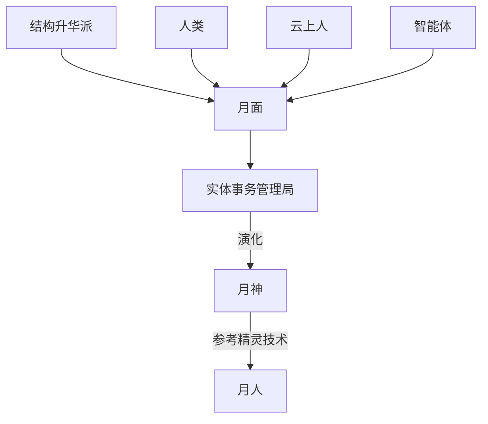

### 6.7 麦哲伦舰内

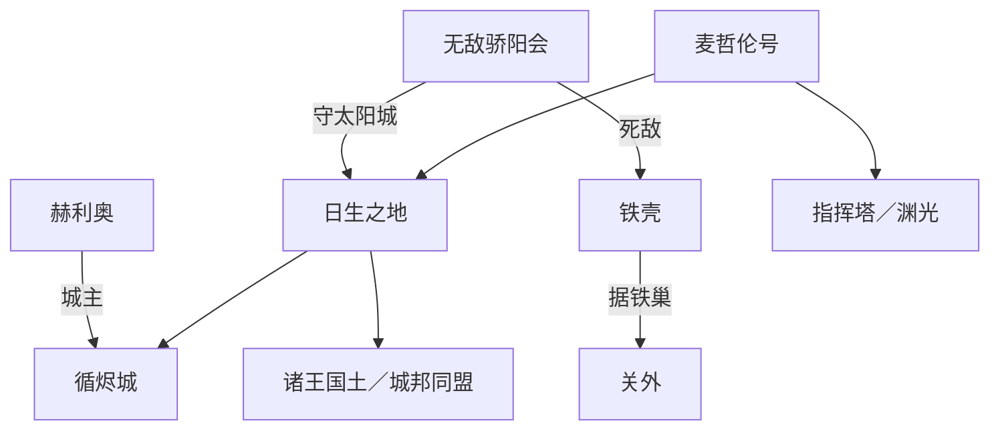

### 6.8 神话人物关系

> 灵界／教典侧神格与魔神关系；现世面相（如昏昼）只作神话下落注，不并入人间势力谱。

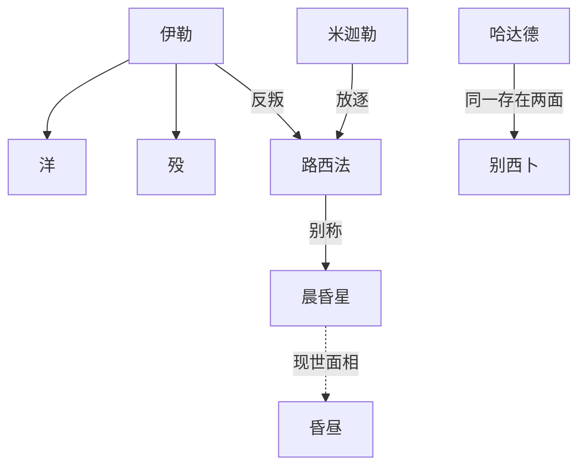

**七罪神（并列）：** 路西法 · 别西卜／哈达德 · 利维坦 · 萨麦尔 · 贝尔芬格 · 玛门 · 阿斯蒙蒂斯

**灵界至高（并列、本体不可寻）：** 光 · 暗 · 天空 · 大地（巴哈姆特）

---

## 七、覆盖与缺口

**已覆盖：** 词条人物／组织／阵营／族群／地点；总世界线；各分支时间线；云上坟场明暗线势力全套；击魄时期与抗击异魔正文（亚冷战之后、休战组成反异魔阵线）；草稿中反复出现的具名者。

**设定本身未命名：** 港／山／高原各单城名；矿业联盟内部各巨企名；巨企 N 真名；学社／自由政府／共信会站内代表人物；织星者无独立词条；七十二柱魔神除七罪神外无全名册。

---

**基于：** 各地点 README、分支时间线、词条、草稿  
**组织原则：** 地区分层；跨区只留接口  
