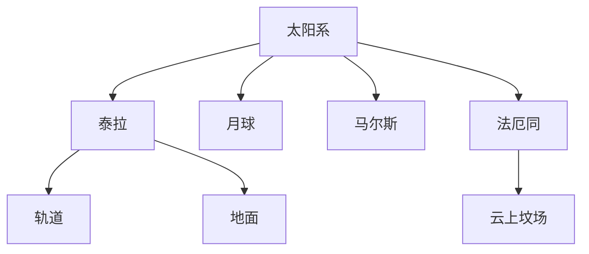

# 总世界线

> 按**地区分层**的索引，不是把各线摊成一条细年表。各区故事以地点 README 与分支时间线为准。本文未经人工校验。

## 写法

- **分层**：上层只索引与接口，不抄下层全文。
- **一区一故事**：因果尽量在本区闭环。
- **跨区低耦合**：只写进出本区的那一句（外溢、坠落、一次技术交付、失联），不展开对方内部。
- **如无必要，勿增实体**：已有地点／组织能承接的，不另立中间地带或新势力。

## 分层

```
太阳系
├── 泰拉（旧称地球）
│   ├── 轨道 → 以太线（研究站）／云上线（服务器阵列；正文在法厄同）
│   └── 地面 → 地面线（众城所在地）／精灵线（世界树）／渊魔（深渊）
├── 月球 → 月球线（不另建地点词条）
├── 马尔斯 → 火星线
└── 法厄同 → 云上线（环带）
    └── 云上坟场（战后微观）
麦哲伦号（舰，属云上线）→ 循光之城
```

目录与正文：[分支时间线/README.md](分支时间线/README.md)。不另立卢娜、灵界、城与邦林立之地。

| 层 | 地点 | 主故事线 |
|------|------|----------|
| 泰拉轨道 | [轨道](词条/地点/泰拉/轨道/README.md) | 🟣 [以太线](分支时间线/泰拉/轨道/以太线.md) · 🟡 云上线（基建） |
| 泰拉地面 | [地面](词条/地点/泰拉/地面/README.md) | 🟢 [地面线](分支时间线/泰拉/地面/众城所在地/地面线.md) · 🔴 [精灵线](分支时间线/泰拉/地面/世界树/精灵线.md) |
| 月球 | — | 🔵 [月球线](分支时间线/月球/月球线.md) |
| 马尔斯 | [马尔斯](词条/地点/马尔斯/README.md) | 🟤 [火星线](分支时间线/马尔斯/火星线.md) |
| 法厄同 | [法厄同](词条/地点/法厄同/README.md) | 🟡 [云上线](分支时间线/法厄同/云上线.md) |
| 法厄同微观 | [云上坟场](云上坟场/README.md) | 明线／暗线 |
| 麦哲伦号 | 舰（非天体） | [循光之城](分支时间线/麦哲伦号/循光之城.md) |



## 共同冲击

**大天灾**（地面宗教叙事称大洪水；云上坟场称大灾变）：以太性质异变、远程航行失效、世界异变同时发生。此后航道切断，**各区失联，分头叙述**。

时代只分三截：前文明末期 → 大天灾 → 破晓时代。各区细目不对齐到同一张总表。

## 跨区接口

只列已有事实，不新增地点或组织。

| 从 | 到 | 接口 |
|------|------|------|
| 大天灾 | 各层 | 航道切断，失联 |
| 月球（灾前） | 马尔斯轨道／云世界 | 器械支援 |
| [轨道研究站](词条/地点/泰拉/轨道/轨道研究站/README.md)（灾前） | 地面节点城 | 以太壁垒技术一次交付 |
| 轨道研究站（灾前） | 云邦扩张 | 以太航行技术一次交付 |
| 云上人 | 马尔斯[智库](词条/组织/智库.md) | 管理权限交出（此后属火星线） |
| 马尔斯轨道 | 法厄同／环带 | [异魔](词条/概念/异魔.md)：穿越机污染**外溢** |
| 太空 | 泰拉地面 | 异魔结构**坠落** → 渊魔／[深渊](词条/地点/泰拉/地面/深渊/README.md) |
| 轨道研究站 | 泰拉地面 | 哈达德（源质实体）坠入，意识再凝聚（以太线转地面） |

灾后求援失败（研究站 → 云邦／月球／马尔斯）只说明「未至」，不在对方地区展开被困实验。

## 入口

### 地点

- [泰拉](词条/地点/泰拉/README.md)
- [马尔斯](词条/地点/马尔斯/README.md)
- [法厄同](词条/地点/法厄同/README.md)
- [云上坟场](云上坟场/README.md)

### 分支时间线

分层目录见 [分支时间线/README.md](分支时间线/README.md)。

- 🔵 [月球线](分支时间线/月球/月球线.md)
- 🟤 [火星线](分支时间线/马尔斯/火星线.md)
- 🟡 [云上线](分支时间线/法厄同/云上线.md)
- 🟣 [以太线](分支时间线/泰拉/轨道/以太线.md)
- 🟢 [地面线](分支时间线/泰拉/地面/众城所在地/地面线.md)
- 🔴 [精灵线](分支时间线/泰拉/地面/世界树/精灵线.md)
- [循光之城](分支时间线/麦哲伦号/循光之城.md)（麦哲伦号舰内）

### 跨区概念（其余见词条，不在此展开）

- [以太](词条/概念/以太.md)
- [云上人](词条/族群/云上人.md)／[云邦](词条/阵营/云邦.md)／[云城](词条/概念/云城.md)
- [异魔](词条/概念/异魔.md)
- [机魂](词条/概念/机魂.md)（派生击魄用语）

---

**基于：** 各地点 README、分支时间线、词条  
**组织原则：** 地区分层；跨区只留接口  
**更新日期：** 26-8-23
